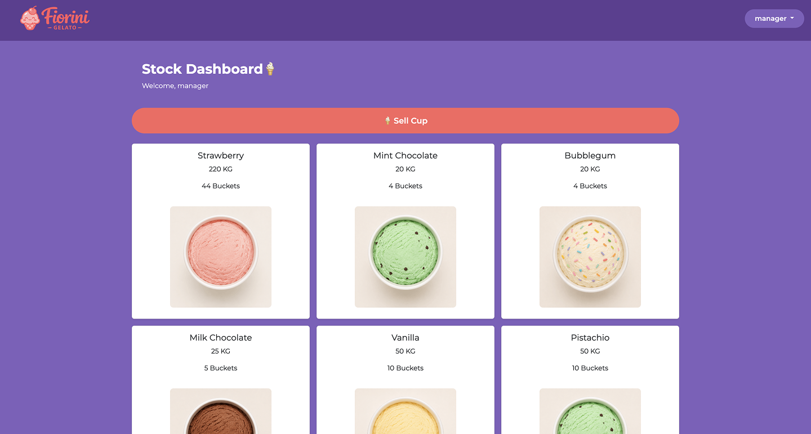

# 🍦 Ice Cream Stock - Fiorini Gelato

This project was inspired by my personal experience working in a gelato shop. The shop had a system to track sales, but there was no proper way to monitor stock levels in real time. I built this tool to fill that gap. It is a simple, visual inventory system that helps manage daily operations and stock by keeping track of flavors, quantities in kilograms, and the number of buckets available. It includes role-based login (Staff and Manager), a visual card dashboard,  and a detailed stock management table.

Built with Java Spring Boot on the back end and vanilla HTML/CSS/JavaScript on the front end.

**Screenshots:**



**What it does:**
- View all flavors as visual cards (with color-coded icons)
- Sell cups and automatically update stock
- Add, edit, and delete flavors (CRUD)
- Role-based views (staff or manager)
- Paginated card view
- Responsive layout

**What I learned:**

- Building a REST API with Spring Boot
- Using JPA/Hibernate for database persistence
- Connecting a frontend to a backend using Fetch API
- Implementing role-based access control
- Managing state with localStorage
- Deploying a Spring Boot application to AWS EC2
- Provisioning and integrating a managed PostgreSQL database on AWS RDS
- Separating development and production configurations via Spring profiles
- Managing secrets through environment variables

---

## Built With

**Backend**  
- Java 17  
- Spring Boot 3.2.0  
- Spring Data JPA (Hibernate)  
- REST API (Spring Web)
- PostgreSQL (via Docker locally / via AWS RDS in production) 
- Maven  

**Frontend**  
- HTML5  
- CSS3 (Bootstrap 5)  
- Vanilla JavaScript (Fetch API)

**Cloud / Infrastructure**
- AWS EC2 (Amazon Linux 2023, t3.micro)
- AWS RDS (PostgreSQL, db.t3.micro)
- AWS Security Groups (network access control)
- AWS VPC (default)

**Tools**  
- Docker (PostgreSQL container)  
- IntelliJ IDEA  
- VS Code  
- Postman (API testing)  
- Git / GitHub  
- DBeaver (database client)

---

## Deployment

I deployed the application on AWS EC2 and integrated it with Amazon RDS for PostgreSQL. The EC2 instance runs the Spring Boot `.jar` with the `prod` profile active, and the database credentials are injected via environment variables at runtime.

**Architecture:**

```
Browser
   │
   │ HTTP (port 8080)
   ▼
AWS EC2 (Amazon Linux 2023)
   └── Java 17
       └── Spring Boot 3.2.0
           ├── Tomcat (embedded, port 8080)
           ├── static/ (frontend: HTML/CSS/JS)
           └── Hibernate + HikariCP
                    │
                    │ TCP (port 5432, private network)
                    ▼
              AWS RDS
                  └── PostgreSQL
                      └── database: icecream_stock
```

**Security:**

- EC2 Security Group: inbound SSH (port 22) restricted to developer IP; inbound HTTP (port 8080) open to the developer IP.
- RDS Security Group: inbound PostgreSQL (port 5432) restricted to the EC2 Security Group only (database is not reachable from the internet).

**Environments:**

- **Development** — runs locally with PostgreSQL via Docker. Uses `application.properties` (default profile).
- **Production** — runs on EC2 against RDS. Uses `application-prod.properties`, activated with `--spring.profiles.active=prod`. Database credentials are injected via environment variables (`DB_USERNAME`, `DB_PASSWORD`), so no secrets are committed to the repository.

---

## Default Users

| Role | Username | Password |
|------|----------|----------|
| Manager | `manager` | `1234` |
| Staff | `staff` | `1234` |

- Demo credentials only, not for production.

---

## Observations:

- I chose to serve the frontend as static resources from Spring Boot to keep deployment simple (one artifact, one runtime). At larger scale, I would extract it to S3 + CloudFront so the EC2 only handles API work.

---

## Getting Started

### 1. Clone the repository
git clone https://github.com/your-username/ice-cream-stock.git
cd ice-cream-stock

### 2. Prerequisites
- Java 17
- Maven (or use the included ./mvnw wrapper)
- Docker (for the local PostgreSQL container)

### 3. Start the local database
docker run -d \
--name icecream-postgres \
-e POSTGRES_DB=icecream_stock \
-e POSTGRES_USER=postgres \
-e POSTGRES_PASSWORD=postgres \
-p 5432:5432 \
postgres:16

### 4. Run the application
./mvnw spring-boot:run

### 5. Access the application
Open http://localhost:8080 and log in with one of the default users.